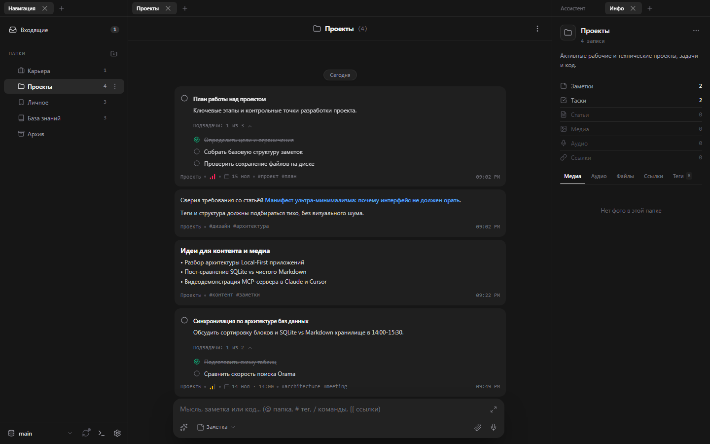
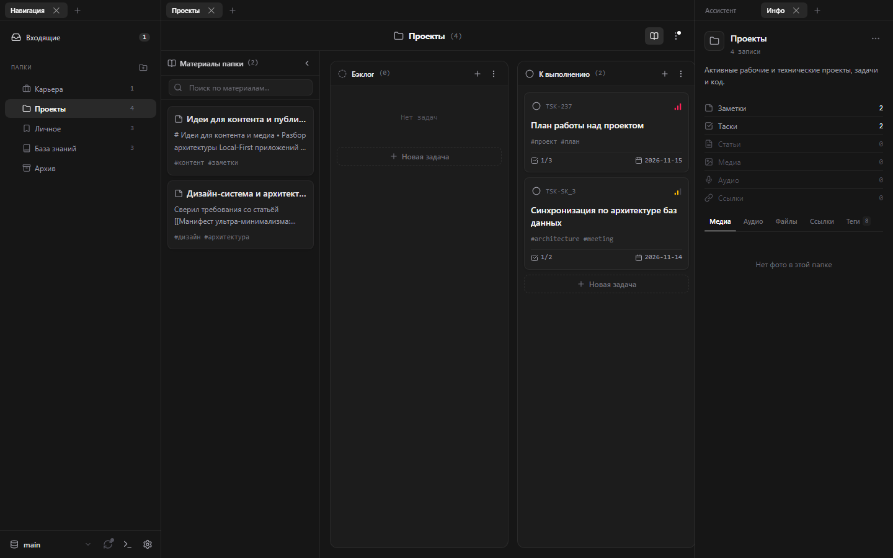
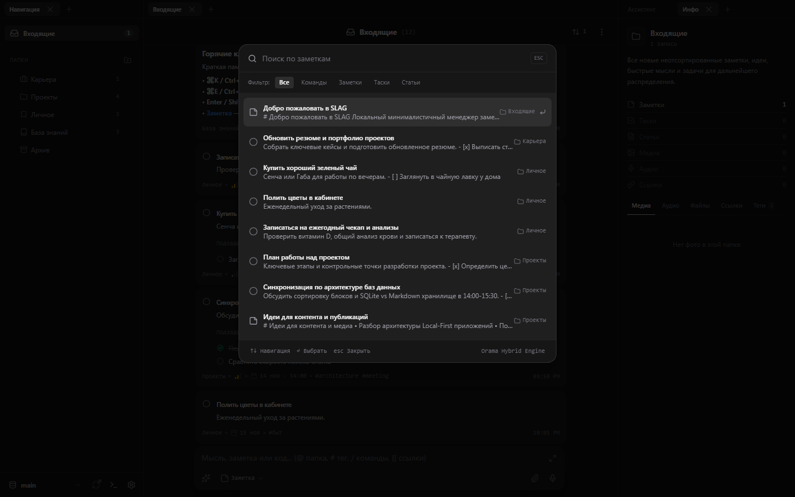
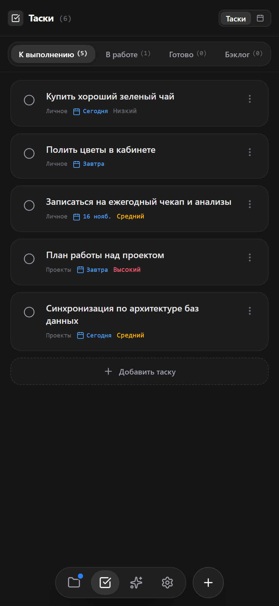
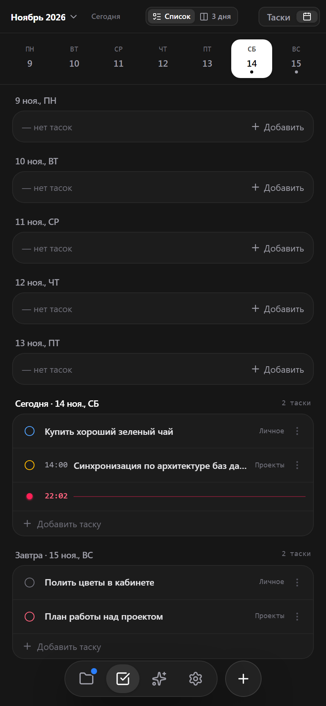
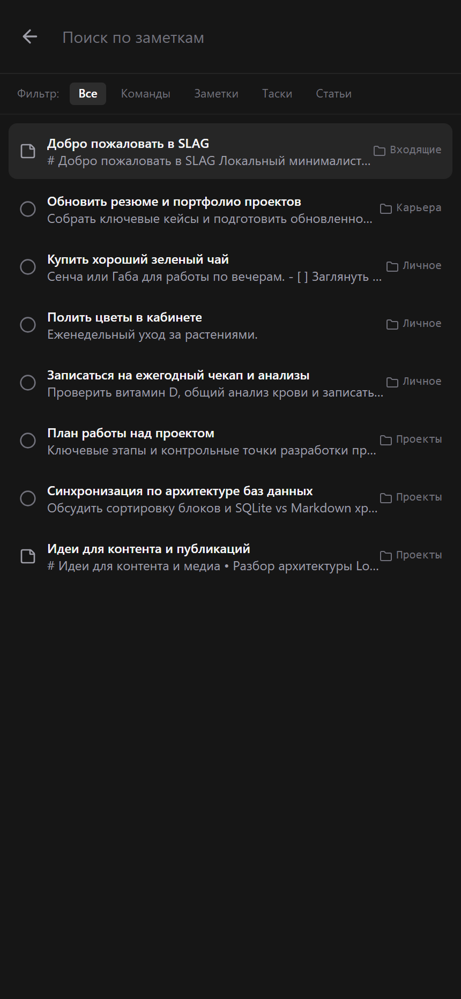
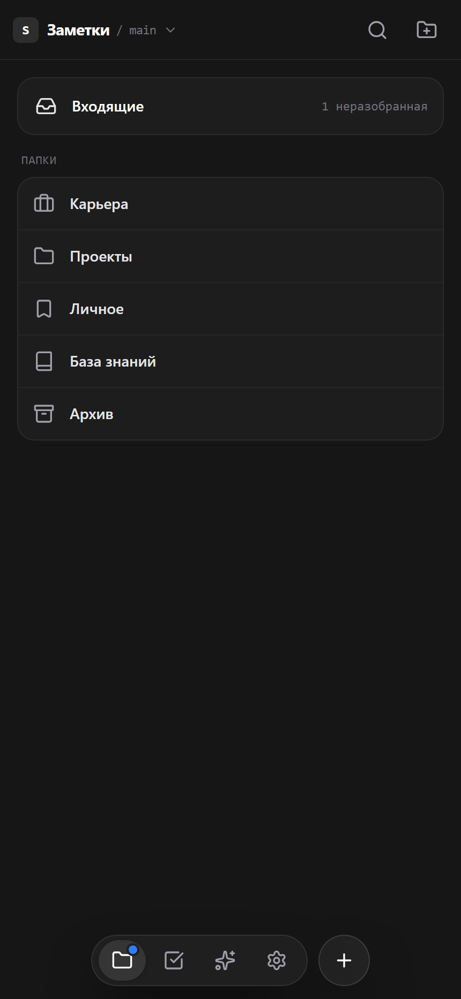

# SLAG v2

Заметки, задачи и статьи в обычных Markdown-файлах. Десктоп на Tauri v2, веб-версия и Android
из одного кода. Данные лежат на диске, синхронизация идёт через свой relay, который не читает
содержимое заметок.

[Скачать для Windows, Linux и Android](https://github.com/wssdozh/slag-v2/releases)

<p align="center"><sub>десктоп</sub></p>
<p align="center">
  
  
  
</p>
<p align="center"><sub>Android</sub></p>
<p align="center">
  
  
  
  
</p>

## Что внутри

- записи хранятся как `.md` с YAML frontmatter; папки и теги лежат рядом, вложения — в
  `.attachments/`, удалённое — в `.trash/`;
- три типа записи: заметка, задача с чеклистом, дедлайном и приоритетом, статья;
- лента, канбан, календарь, полноэкранный редактор, поиск Orama;
- голосовые заметки с расшифровкой, видео-кружки, вложения;
- ИИ-теги, триаж «Входящих» и ассистент: Groq, Gemini, KIE или любой OpenAI-совместимый
  endpoint;
- E2EE-синк между устройствами, аккаунт, напоминания в Telegram;
- MCP-сервер для внешних агентов.

## Быстрый старт

Нужны Node 22+, pnpm; для нативных сборок — Rust и Android SDK.

```sh
pnpm install
pnpm dev
```

`pnpm dev:desktop` запускает окно Tauri с HMR.

## Сборка и проверки

```sh
pnpm build          # web + mcp + node
pnpm build:desktop
pnpm build:android
pnpm check          # tsc + oxlint
npx playwright test
```

account-спеки требуют клон `wssdozh/slag-relay` рядом с репозиторием или путь в
`SLAG_RELAY_DIR`; без него они пропускаются.

## Где что лежит

| путь | что там |
|---|---|
| `src/` | React UI, контекст, хуки, `lib/` |
| `src-tauri/` | Rust-оболочка, десктоп и Android |
| `e2e/` | Playwright |
| `config/` | Vite, tsconfig, oxlint |
| `docs/` | архитектура, карта кода, гайды |
| `scripts/` | карта кода, релиз, иконки, замеры поиска |

Сервер синхронизации и telegram-бот живут отдельно:
[wssdozh/slag-relay](https://github.com/wssdozh/slag-relay).

## Документация

- [BUILD.md](BUILD.md) — режимы сборки
- [docs/CODE_MAP.md](docs/CODE_MAP.md) — карта модулей
- [docs/mcp-guide.md](docs/mcp-guide.md) — MCP
- [docs/sync-architecture.md](docs/sync-architecture.md) — контракт синка
- [docs/RELEASING.md](docs/RELEASING.md) — релизы
- [docs/app-knowledge-base.ru.md](docs/app-knowledge-base.ru.md) — UI и горячие клавиши
- [releases](https://github.com/wssdozh/slag-v2/releases)
