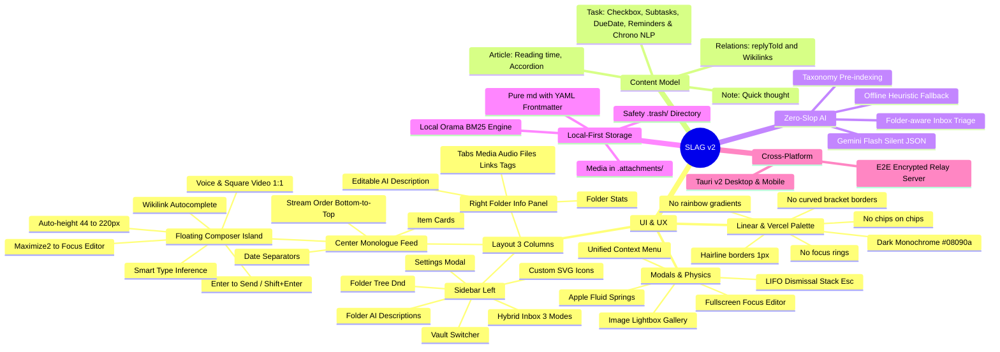

# 🗺️ SLAG v2: Map of Content (Карта Проекта)

> **SLAG v2 (Stream-based Local-first Annotated Graph)** — персональная, локальная (Local-First) система для ведения заметок, статей и задач, спроектированная так, чтобы быть **«понятной даже с первого взгляда»**.
> 
> Продукт объединяет быстроту монолога Telegram, эстетику ультра-чистого монохрома Linear & Vercel, открытые данные Obsidian (Markdown + YAML Frontmatter) и физику Apple Fluid Interface.

---

## 🧭 Навигация по модулям базы знаний

База знаний структурирована в виде взаимосвязанной сети документов:

```
                  ┌──────────────────────────────┐
                  │ 00_MOC_Map_of_Content.md     │
                  └──────────────┬───────────────┘
          ┌──────────────────────┼──────────────────────┐
          ▼                      ▼                      ▼
┌───────────────────┐  ┌───────────────────┐  ┌───────────────────┐
│ 01_UI_UX_Matrix   │  │ 02_Data_Model     │  │ 03_AI_Engine      │
│ Дизайн, ЛКМ / ПКМ │  │ .md, YAML, .trash │  │ Теги, триаж       │
└─────────┬─────────┘  └─────────┬─────────┘  └─────────┬─────────┘
          │                      │                      │
          └──────────────────────┼──────────────────────┘
          ┌──────────────────────┴──────────────────────┐
          ▼                                             ▼
┌───────────────────┐                         ┌───────────────────┐
│ 04_Multimedia     │                         │ 05_Search_Orama   │
│ Войс, Квадраты 1:1│                         │ Локальный BM25    │
└─────────┬─────────┘                         └─────────┬─────────┘
          │                                             │
          └──────────────────────┬──────────────────────┘
          ┌──────────────────────┴──────────────────────┐
          ▼                                             ▼
┌───────────────────┐                         ┌───────────────────┐
│ 06_E2E_Sync       │                         │ 07_Roadmap        │
│ Relay Non-Storage │                         │ Этапы и чек-листы │
└─────────┬─────────┘                         └─────────┬─────────┘
          │                                             │
          └──────────────────────┬──────────────────────┘
          ┌──────────────────────┴──────────────────────┐
          ▼                                             ▼
┌───────────────────┐                         ┌───────────────────┐
│ 08_AI_Chat        │                         │ 09_Folder_Views   │
│ RAG + Tool Calling│                         │ Стрим/Канбан/Кален│
└─────────┬─────────┘                         └─────────┬─────────┘
          │                                             │
          └──────────────────────┬──────────────────────┘
                                 ▼
                      ┌───────────────────┐
                      │ 10_Smart_Dates    │
                      │ Напоминания,Chrono│
                      └─────────┬─────────┘
                                │
                                ▼
                      ┌───────────────────┐
                      │ 11_Composite_UI   │
                      │ Dockview, Popout  │
                      └───────────────────┘
```

1. [[01_UI_UX_Interactions_Matrix]] — Дизайн-система Linear & Vercel, правила верстки, запреты, стек LIFO и исчерпывающая матрица ЛКМ vs ПКМ.
2. [[02_Data_Model_Obsidian_Vault]] — Архитектура локального хранилища, структура `.md` файлов, стандарт Frontmatter, корзина `.trash/` и автоопределение типов.
3. [[03_AI_Engine_Zero_Slop_Gemini]] — Интеллектуальный слой без слопа: предварительная индексация таксономии тегов, AI Triage папки «Входящие», оффлайн-эвристика.
4. [[04_Multimedia_Engine]] — Мультимедийные компоненты: аудиосообщения с волной, видео-квадратики (1:1, лимит 60с), галерея Lightbox.
5. [[05_Search_Orama_Local_First]] — Мгновенный оффлайн-поиск BM25 на базе Orama, шорткат `⌘K`, индексация и фильтры.
6. [[06_E2E_Sync_Architecture]] — Мобильная адаптация на Tauri v2 и архитектура клиентского сквозного шифрования (AES-256-GCM) через Relay-сервер без хранения (Non-Storage).
7. [[07_Roadmap_Implementation]] — Дорожная карта реализации, текущий статус и контрольные чек-листы готовности.
8. [[08_AI_Chat_Agentic_RAG]] — ИИ-чат с заметками, агентный поиск через Function Calling + Orama, статистика тегов и папок, управление Reasoning (Gemini, Groq, KIE).
9. [[09_Folder_Views_Stream_Kanban_Calendar]] — Мульти-представления папки: Стрим-лента, Канбан с кастомными столбцами по ТРИЗ и Календарь дедлайнов. Разделение с правым Копилотом (`⌘J`).
10. [[10_Smart_Dates_and_Reminders]] — Умный разбор дат (chrono-node RU/EN), интерактивные Ghost-чипы в композере, краевая фильтрация и системные уведомления.
11. [[11_Composite_Workspace_Dockview]] — Модульная композитная IDE-сетка на базе `dockview-react`, произвольные сплиты, вкладки, сохранение схем и нативные Popout-окна в Tauri v2.
12. [[12_Logging_Diagnostics_Engine]] — Архитектура логирования и инспекции (SLAG Logger & HUD), zero-dependency кольцевой буфер, маскировка ключей, фильтры и генератор отчетов.

---

## ⚡ Интерактивная Mermaid Mindmap



---

## ⌨️ Быстрый справочник горячих клавиш

| Сочетание | Действие | Контекст |
|---|---|---|
| `Enter` | Мгновенная отправка записи в стрим-ленту | Поле ввода композера |
| `Shift + Enter` | Перенос строки без отправки | Поле ввода композера |
| `[[` | Вызов автокомплита вики-ссылок по заметкам | Поле ввода композера / Редактор |
| `⌘K` / `Ctrl+K` | Открытие глобального командного поиска Orama | В любом месте приложения |
| `⌘E` / `Ctrl+E` | Открытие выбранной записи в Focus Editor | При наведении на карточку |
| `Escape` | Послойное закрытие верхнего активного оверлея (LIFO) | В любом месте приложения |
| `R` | Ответить на заметку (цитирование над композером) | При наведении на карточку |
| `P` | Закрепить / открепить запись вверху ленты | При наведении на карточку |
| `⌫` / `Delete` | Безопасное перемещение записи в `.trash/` | Контекстное меню карточки |
| `←` / `→` | Перелистывание картинок активной папки | Внутри Image Lightbox |
