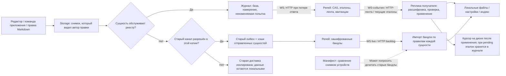
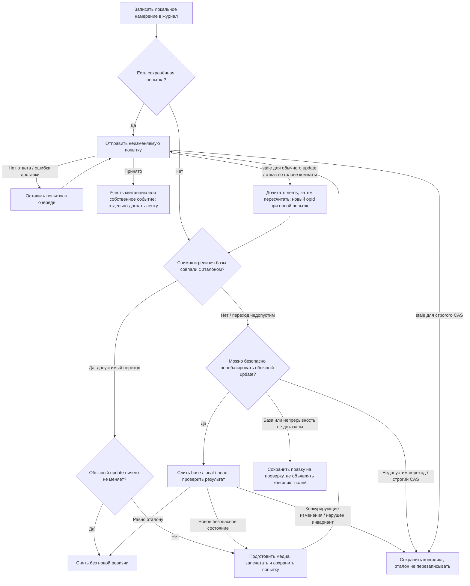

# SLAG: карта синхронизации и конфликтов

**Основа схемы — установленная [SLAG `0.2.5-dev.81`](https://github.com/wssdozh/slag-v2/releases/tag/v0.2.5-dev.81)**: [исходники `f2a10335`](https://github.com/wssdozh/slag-v2/tree/f2a1033518a58e2c3cc139131d6dab5158daeeba), [сборка CI](https://github.com/wssdozh/slag-v2/actions/runs/45360752371). Ссылки на код ведут к этой сборке, а не к незавершённой рабочей ветке. Реализацию CAS сверял с [серверной веткой реестра `06e6be7`](https://github.com/wssdozh/slag-relay/blob/06e6be7a5bba60416cd5bdaaa7727d24701c54e2/store/note_registry.py); это не подтверждение коммита на рабочем релее. См. также [контракт синхронизации](https://github.com/wssdozh/slag-v2/blob/f2a1033518a58e2c3cc139131d6dab5158daeeba/docs/sync-architecture.md).

### Рабочая комната: проверка на `dev.81`, 24.11.2026 в 12:14 МСК

Удаление «Архива» было принято как `267`, но `dev.80` не убирала совпавший пункт проверки после живого события — только после дочитывания. `dev.81` сверяет совпавшие варианты и после полностью применённой живой ленты; отличающиеся не снимает. На рабочем релее отдельная папка создана на Android (`269`), применена на Windows и Linux, затем удалена через Windows (`270`). На обоих компьютерах проверены реестр и каталог, на телефоне — список папок и отчёт. На всех трёх применена `270`, очередь реестра пуста, подтверждённых конфликтов нет. Одна старая правка Android осталась на проверку. На Android до обновления стояла `dev.77` и блокировался переход со старой очереди; обновление выполнено без сброса данных.

### Предыдущий замер на `dev.80`: 24.11.2026 в 10:03 МСК

Поколение `1`; дерево папок, атомарные группы и медиа идут через реестр. `sharedRecords` выключен: общие черновики и другие общие записи этим реестром не обслуживаются. У Windows и Linux совпали **подтверждённые эталоны реестра**: применённая ревизия `266`, 107 живых записей (включая контрольную задачу), 23 папки, 64 метки удаления. В обеих копиях по 107 файлов Markdown, очередь реестра пуста и подтверждённых конфликтов нет. Это снимок дисков устройств, а не замер текущей головы сервера.

| Устройство | Активная копия и старый канал | Что осталось на проверку |
|---|---|---|
| Windows | `main (реестр)` — отдельная локальная копия той же комнаты. Старый пакетный канал в ней изолирован, очередь исходного `main` неизвестна и остаётся под защитной паузой. | 2 варианта из исходного хранилища, в том числе предложение удалить папку. |
| Linux-ноутбук | Обычная копия комнаты; старый канал доступен для совместимых сущностей, его очередь пуста. | 1 снимок из старой очереди без доказанной базы (`legacy-cutover`). |

На подписанной сборке проверена доставка контрольной задачи и правок приоритета в обе стороны, в том числе после перезапуска обоих приложений. Android и Pi в эту проверку не входили. [Протокол приёмки](https://github.com/wssdozh/slag-v2/blob/2d94464c/.agents/tasks/sync-health-and-legacy-review.md#L11-L16).

## 1. Два транспорта, разные правила

- **Реестр** обязателен для заметок, задач, статей и их явных удалений/восстановлений в комнате `registry`. `folderTree` переводит целое дерево папок (включая порядок); `atomicGroups` добавляет атомарные каскады. `sharedRecords` переводит общие факты, синхронизируемые черновики и общие поля профиля/настроек (например, промпт, персону, предпочтения уведомлений). `registryMedia` переводит байты вложений. Локальная навигация и история чата не становятся общими записями. Бандлы остаются для совместимых сущностей, но не могут изменить те, которые уже обслуживает реестр. [Выбор режима](https://github.com/wssdozh/slag-v2/blob/f2a1033518a58e2c3cc139131d6dab5158daeeba/src/lib/sync/notes/session.ts#L34-L75) · [фильтр отправки](https://github.com/wssdozh/slag-v2/blob/f2a1033518a58e2c3cc139131d6dab5158daeeba/src/lib/sync/syncEngine.ts#L551-L556) · [фильтр импорта](https://github.com/wssdozh/slag-v2/blob/f2a1033518a58e2c3cc139131d6dab5158daeeba/src/lib/sync/applyBundle.ts#L128-L167).
- **Старый протокол** пакует изменившиеся по хэшам сущности целиком, а не трёхсторонние патчи. `syncId` у бандла — его порядковый номер доставки, не ревизия заметки. При импорте старых заметок сравнивается `updatedAt`. Обычный `upsert` не снимает уже известную метку удаления; для этого есть явный `restore`. Поэтому «в реестре часы не выбирают победителя» нельзя переносить на старый протокол. [Сборка бандла](https://github.com/wssdozh/slag-v2/blob/f2a1033518a58e2c3cc139131d6dab5158daeeba/src/lib/sync/pushBundle.ts#L81-L114) · [импорт и tombstone](https://github.com/wssdozh/slag-v2/blob/f2a1033518a58e2c3cc139131d6dab5158daeeba/src/lib/sync/applyBundle.ts#L133-L165) · [restore](https://github.com/wssdozh/slag-v2/blob/f2a1033518a58e2c3cc139131d6dab5158daeeba/src/lib/sync/applyBundle.ts#L226-L239).
- **Манифест** показывает отличие снимков, может запустить чтение уже сохранённых бандлов, но сам не создаёт правок и не доказывает удаление. В реестре «сверить сейчас» запускает скан эталонов и догон ленты. [Маршрутизация сверки](https://github.com/wssdozh/slag-v2/blob/f2a1033518a58e2c3cc139131d6dab5158daeeba/src/lib/sync/syncEngine.ts#L562-L577) · [сверка манифеста](https://github.com/wssdozh/slag-v2/blob/f2a1033518a58e2c3cc139131d6dab5158daeeba/src/lib/sync/manifest/sync.ts#L47-L86).

## 2. Что именно версионируется

| Термин | Что означает |
|---|---|
| `baseRevision` / `base.item` | Ревизия **конкретной записи** и снимок, от которого автор начал править. Номер сам по себе не доказывает происхождение снимка. База `0` используется при создании новой записи. |
| `local` / `intentId` | Локальное намерение: операция и полный снимок, который хотел сохранить автор. Новое сохранение может заменить ещё не отправленное намерение, но не уже запечатанную попытку. |
| `head` записи | Последний известный эталон этой записи. Он живой либо tombstone (удаление). Не путать с `head` комнаты. |
| `head` комнаты / `floor` | Последняя ревизия комнаты / граница, до которой лента уже недоступна. Номера ревизий общие для комнаты: между двумя изменениями одной заметки могут быть изменения других записей. |
| `opId` | ID **одной попытки**. Та же операция, отправитель и байты → та же сохранённая квитанция. Потеря ответа не даёт права менять попытку. `requestId` связывает запрос и ответ, но не заменяет `opId`. |
| `cursor` / `appliedThrough` | До какой позиции клиент надёжно учёл ленту. Квитанция может подтвердить запись на релее, не продвинув курсор. Пока видна ожидающая локальная правка, принятый эталон может быть в журнале, а не в видимом файле. |
| Дисковая проекция | Версия, которую устройство действительно записало и способно снова разобрать из Markdown/YAML. Не обязательно совпадает с оптимистической версией на экране. |

CAS («сравнить и записать»): релей принимает операцию, только если `baseRevision` совпадает с текущей ревизией записи и переход допустим. Тело релей не читает: он проверяет видимые метаданные, квоты и ссылки на зашифрованные медиа. Слияние выполняет клиент. [Формат и шифрование](https://github.com/wssdozh/slag-v2/blob/f2a1033518a58e2c3cc139131d6dab5158daeeba/src/lib/sync/notes/wire.ts#L157-L184) · [структура журнала](https://github.com/wssdozh/slag-v2/blob/f2a1033518a58e2c3cc139131d6dab5158daeeba/src/lib/sync/notes/journal.ts#L11-L79) · [CAS и квитанции на сервере](https://github.com/wssdozh/slag-relay/blob/06e6be7a5bba60416cd5bdaaa7727d24701c54e2/store/note_registry.py#L260-L339).

## 3. Жизнь одной правки

Схема опускает две проверки: отсутствие эталона для изменения существующей записи может оставить правку в очереди **с ошибкой**, а не открыть конфликт; проверенное следующее автосохранение может потребовать переноса своего вклада даже при совпавшем номере ревизии, если видимый снимок отличается от принятого. [Выбор кандидата](https://github.com/wssdozh/slag-v2/blob/f2a1033518a58e2c3cc139131d6dab5158daeeba/src/lib/sync/notes/reconcile.ts#L10-L45) · [подготовка и отправка](https://github.com/wssdozh/slag-v2/blob/f2a1033518a58e2c3cc139131d6dab5158daeeba/src/lib/sync/notes/replica.ts#L710-L872) · [разбор квитанций](https://github.com/wssdozh/slag-v2/blob/f2a1033518a58e2c3cc139131d6dab5158daeeba/src/lib/sync/notes/replica.ts#L982-L1066).

- **Чему верит слияние.** `confirmedBase` продолжает доказанную цепочку (`since`), только когда наблюдаемый `update` ссылается на предыдущую ревизию этой записи. `delete`/`restore` разрывают цепочку даже при том же ID и том же тексте. Скан текущих эталонов (`note-heads`) помогает восстановить данные, но не подтверждает пропущенные переходы. При `cursor < floor` клиент сканирует эталоны до зафиксированной границы и дочитывает ленту дальше. [Проверка цепочки](https://github.com/wssdozh/slag-v2/blob/f2a1033518a58e2c3cc139131d6dab5158daeeba/src/lib/sync/notes/reconcile.ts#L10-L43) · [догон и восстановление](https://github.com/wssdozh/slag-v2/blob/f2a1033518a58e2c3cc139131d6dab5158daeeba/src/lib/sync/notes/replica.ts#L598-L707).
- **Что происходит между двумя автосохранениями.** Если первая правка уже отправлена, вторая хранит связь с тем локальным снимком, который пользователь видел. Когда первый результат включает ещё и чужие изменения, второе сохранение переносит только свой вклад, а не стирает их. Если первая правка отклонена, а у второй нет самостоятельной базы, вторая идёт на проверку с причиной `predecessor`. [Связь намерений](https://github.com/wssdozh/slag-v2/blob/f2a1033518a58e2c3cc139131d6dab5158daeeba/src/lib/sync/notes/journal.ts#L91-L125) · [разбор предшественника](https://github.com/wssdozh/slag-v2/blob/f2a1033518a58e2c3cc139131d6dab5158daeeba/src/lib/sync/notes/journal.ts#L160-L170).
- **Как раскладывается трёхстороннее слияние.** Если поле изменилось на одной стороне — берём эту сторону; если на обеих одинаково — берём один раз. Если различно — специальное правило для Markdown, тегов или отдельных ключей `customProps`, иначе конфликт. После сборки проверяются связи между полями. Имена файлов, часы, CRLF и известные значения по умолчанию не создают конфликта сами по себе; состояние обработки вложения `processing` не считается общим полем. Подзадачи, извлекаемые из Markdown, пересчитываются из результата, а не сливаются вторым списком. [Поля заметки](https://github.com/wssdozh/slag-v2/blob/f2a1033518a58e2c3cc139131d6dab5158daeeba/src/lib/vault/noteSemantics.ts#L5-L30) · [merge](https://github.com/wssdozh/slag-v2/blob/f2a1033518a58e2c3cc139131d6dab5158daeeba/src/lib/sync/notes/merge.ts#L36-L95) · [проверка результата](https://github.com/wssdozh/slag-v2/blob/f2a1033518a58e2c3cc139131d6dab5158daeeba/src/lib/sync/notes/mergeValidation.ts#L17-L49).

### Пример: устаревшая база — ещё не конфликт

Оба устройства открыли заметку на `r41`. А изменил заголовок; релей принял правку на `r42`. Б без сети изменил текст. Если Б может доказать переход `r41 → r42`, он берёт заголовок из `r42`, текст из своей правки и отправляет результат с базой `r42`. Если оба по-разному изменили заголовок, релей оставляет `r42`, а Б сохраняет свой полный снимок для сравнения. Если вместо `r42` между версиями прошли `delete → restore`, объединения не будет, даже если восстановленный текст совпал с `r41`.

## 4. Матрица граничных ситуаций

| Ситуация | Почему возникает | Что делает движок |
|---|---|---|
| А меняет заголовок, Б — тело; оба пришли с общей доказанной базы | Два независимых вклада | Объединяет. Если результат уже на релее, отдельной ревизии не нужно. |
| Оба сделали одно и то же | Возможно, вручную применили одинаковую правку или watcher увидел своё эхо | Эквивалентный `update` снимается; эхо собственной проекции не считается новой правкой. |
| Два разных заголовка; две разные правки одной строки; две разные вставки в одной позиции | Нельзя вывести намерение и порядок из трёх снимков | Конфликт поля (`title`, `content` и т. п.); частично собранную заметку не отправляет. |
| Изменились соседние строки или абзацы | Якорь между правками может отсутствовать | Сливает, если это однозначные непересекающиеся замены обычного текста. Повторяющиеся строки конфликтуют, когда позицию нельзя доказать. См. [алгоритм по строкам](https://github.com/wssdozh/slag-v2/blob/f2a1033518a58e2c3cc139131d6dab5158daeeba/src/lib/text/mergeMarkdown.ts#L51-L119). |
| Одна сторона сдвинула ограждение кода, другая тоже изменила тело; либо два разных изменения тела при размере свыше 256 КиБ / 8 000 строк | Структурный риск или лимит алгоритма | Не угадывает. Одностороннее/одинаковое изменение тела проходит без этого анализа. |
| Один удалил старый тег, другой добавил независимый | Теги сравниваются по точному значению | Сливает; сохраняет порядок оставшихся, сортирует новые в конце. Разный регистр нового тега, дубли, перестановка сохранившихся тегов или два разных замещения общего удалённого тега могут дать конфликт. Остальные массивы в общем случае сравниваются целиком. |
| А меняет срок, Б — напоминание; А завершает повтор, Б меняет его расписание; А превращает задачу в заметку, Б меняет срок | Поля разные, но результат может быть недопустим или изменить смысл | Валидация останавливает комбинацию (`reminder`, `recurrence`, `type`). Аналогично ловит некоторые несогласованные изменения встраивания и списка вложений. |
| `update` против `delete`; старый `delete` против вновь восстановленной записи; два `create` с одним ID | Стороны работают с разным состоянием или разной «жизнью» одного ID | Строгий CAS для переходов; устаревший `update` не воскресит, старый `delete` не уничтожит восстановленное, второй `create` не заменит первый. |
| Отсутствует база / журнал видел только текущий эталон после истечения ленты | Нет доказательства, что правки начаты из одного состояния и не было `delete`/`restore` | Сохраняет альтернативу, если правка не проходит прямой CAS. У доказанного `update` разрыв цепочки может называться `lifecycle`, даже если явное удаление не наблюдалось. |
| Файл исчез при скане; два файла с одним ID после внешнего копирования; правка вне приложения при выключенном клиенте | Отсутствие пути ≠ намерение удалить; копия или маркер ≠ доказательство всей YAML-базы | Watcher не создаёт tombstone из отсутствия файла. Cold recovery до pull ищет однозначную копию среди известных заметок, переносит только изменённое тело на последней сохранённой базе; не подставляет свежую ревизию и не делает авторебейз. [Watcher](https://github.com/wssdozh/slag-v2/blob/f2a1033518a58e2c3cc139131d6dab5158daeeba/src/lib/storage/index.ts#L1051-L1112) · [cold recovery](https://github.com/wssdozh/slag-v2/blob/f2a1033518a58e2c3cc139131d6dab5158daeeba/src/lib/sync/notes/replica.ts#L375-L429). |
| А переименовывает папку, Б добавляет туда заметку; два устройства переставили папки | В обоих случаях изменился состав каскада или тот же снимок дерева | С `atomicGroups` сверяет применённую голову комнаты и все базы группы, принимает каскад целиком. Простое продвижение головы → дочитать и перепроверить; если появился неучтённый член или участник изменился — не применяет неполный каскад. При сбое проекции действует защитная метка, группа переигрывается без частичного курсора. [Проверка группы](https://github.com/wssdozh/slag-v2/blob/f2a1033518a58e2c3cc139131d6dab5158daeeba/src/lib/sync/notes/replica.ts#L746-L768) · [защита на диске](https://github.com/wssdozh/slag-v2/blob/f2a1033518a58e2c3cc139131d6dab5158daeeba/src/lib/storage/index.ts#L416-L446). |
| Два устройства меняют общий факт/черновик; открытый редактор обогнала версия с релея | Общая запись не обычная заметка; основа редактора могла смениться | Только строгий CAS, без слияния Markdown. Ветка обогнанного редактора может сразу сохранить альтернативу `editor`, не делая сетевую попытку. [Общие записи](https://github.com/wssdozh/slag-v2/blob/f2a1033518a58e2c3cc139131d6dab5158daeeba/src/lib/sync/notes/replica.ts#L337-L358). |
| Релей уже записал ревизию, но ответ потерялся; своё событие пришло раньше ответа | Транспорт и применение асинхронны | Повторяет сохранённые `opId` и байты, дубль не создаёт ревизию. Клиент может учесть результат по своему событию. ACK и применение ленты — разные вещи. |
| Получили событие через пропуск, не пишется диск/журнал, нет байтов вложения или сработала квота | Доставка, локальное применение и содержательное согласование — разные этапы | Дочитывает с прежнего надёжного курсора или оставляет попытку в очереди. При `registryMedia` байты загружаются до публикации ссылки и проверяются/пишутся перед применением эталона. Это не повод выбрать другую версию текста. [Применение медиа](https://github.com/wssdozh/slag-v2/blob/f2a1033518a58e2c3cc139131d6dab5158daeeba/src/lib/sync/notes/session.ts#L119-L183). |
| После миграции осталась запись в старой очереди | Старый снимок не несёт доказанной базы реестра | В обычной копии с разрешённой записью распознанные upsert заметок и поддержанные операции черновиков (если включён `sharedRecords`) сначала сохраняются в журнале как `legacy-cutover`, затем снимаются из старой очереди. После догона эквивалентные версии убираются без отправки, отличия показываются в «Старых правках на проверку». Черновики комнаты, где `sharedRecords` выключен, не переносятся этим шагом. Если обнаружена неподдержанная переносимая операция (например, каскад папок или восстановление из корзины), шаг останавливается: старые записи не удаляются. [Классификация](https://github.com/wssdozh/slag-v2/blob/f2a1033518a58e2c3cc139131d6dab5158daeeba/src/lib/sync/notes/legacyCutover.ts#L27-L74) · [порядок записи](https://github.com/wssdozh/slag-v2/blob/f2a1033518a58e2c3cc139131d6dab5158daeeba/src/lib/sync/syncEngine.ts#L1218-L1240). |
| Сменились хранилище/режим/поколение, пропал доступ или не читается локальный журнал | Нет основания считать прочитанное состояние корректным и относящимся к этой комнате | Защитная остановка, не merge и не доказательство пустой очереди. Уже подключённый реестр не откатывается в legacy по ошибке. [Проверка сессии](https://github.com/wssdozh/slag-v2/blob/f2a1033518a58e2c3cc139131d6dab5158daeeba/src/lib/sync/notes/session.ts#L216-L231) · [валидация журнала](https://github.com/wssdozh/slag-v2/blob/f2a1033518a58e2c3cc139131d6dab5158daeeba/src/lib/sync/notes/persistence.ts#L60-L99). |

## 5. Что видно пользователю и что проверять

| Состояние | Где смотреть и что оно означает |
|---|---|
| Сбой отправки, чтения или записи на диск | Значок синхронизации → «Состояние хранилища»: связь, локальная пауза, последний ответ релея, обе ревизии, обе очереди. Это не конфликт содержимого. |
| Старые правки на проверку | Настройки → Синхронизация → «Старые правки на проверку». Старый снимок без базы (`legacy-cutover`), не вывод о том, что два автора изменили одно поле. |
| Правки на проверку | Там же, в отдельном разделе. База, предшественник или непрерывность не подтверждены; сюда же попадают отличия из исходной копии (`recovered-disk`). |
| Конфликты синхронизации | Конкурирующие изменения, недопустимый переход или неделимая операция, которую нельзя повторить на текущей базе. Запись в списке сама по себе не делает доставку других заметок ошибкой. |

1. **Проверить область:** версия, активная копия, комната и поколение, возможности, `receive-only`. Если старый журнал утрачен, размер его очереди **неизвестен**, а не `0`. В отчёте восстановленной копии старый канал отмечен как изолированный. Если проверка файлов не запускалась, отчёт так и говорит. [Отчёт](https://github.com/wssdozh/slag-v2/blob/f2a1033518a58e2c3cc139131d6dab5158daeeba/src/lib/sync/diagnostics.ts#L18-L55).
2. **Разделить стадии:** локальное намерение → сохранённая попытка → квитанция релея → применённая ревизия получателя → файл и медиа. Смотреть `appliedThrough` и наблюдаемую `relayHead`, затем сверить нужную запись на втором устройстве, при необходимости после рестарта. Пустая очередь не означает отсутствие альтернатив, связь с релеем не подтверждает запись на другом устройстве. [Статус реплики](https://github.com/wssdozh/slag-v2/blob/f2a1033518a58e2c3cc139131d6dab5158daeeba/src/lib/sync/notes/replica.ts#L103-L120).
3. **Найти намерение и попытку:** в событиях `Note intent recorded`, `Note attempt dispatched`, `Note accepted`, `Note conflict saved`, `Note projection failed`, `Note journal write failed` сопоставить `intentId`, `opId`, `baseRevision` и источник (`app`, `disk-watch`, `cold-recovery`, `retry`). Один `opId` в WS и HTTP означает повтор той же попытки; новый после догона — новую попытку. Эти события не содержат текста заметки или значений полей. [Фиксация результата](https://github.com/wssdozh/slag-v2/blob/f2a1033518a58e2c3cc139131d6dab5158daeeba/src/lib/sync/notes/replica.ts#L515-L544).
4. **Разобрать альтернативу:** «Сравнить» показывает значения полей; если менялись только свойства, пустого текстового диффа нет. «Оставить версию релея» убирает альтернативу. Для двух живых версий **одного типа** «Отправить выбранное» накладывает выбранные свойства или отредактированное тело на просмотренный эталон, сохраняя остальные значения. `folder`, `attachments`, `type` не входят в выбор по полям; связанные свойства проверяются вместе. Смена типа, создание/восстановление, удаление и повтор обычной папочной группы — не частичные операции. Если просмотренная ревизия сменилась или по той же записи ждёт операция, нужно снова сравнить; для группы проверяется каждый участник. [Диалог](https://github.com/wssdozh/slag-v2/blob/f2a1033518a58e2c3cc139131d6dab5158daeeba/src/components/Settings/sync/SyncConflictReview.tsx#L26-L84) · [проверка полей](https://github.com/wssdozh/slag-v2/blob/f2a1033518a58e2c3cc139131d6dab5158daeeba/src/lib/sync/notes/review.ts#L15-L44) · [применение решения](https://github.com/wssdozh/slag-v2/blob/f2a1033518a58e2c3cc139131d6dab5158daeeba/src/lib/sync/notes/replica.ts#L152-L225).

**Пример с ноутбука.** В старом снимке текст совпадал, отличались срок `20.11 → 23.11` и серия «не задана → 0». Автоперенос срока повторяющейся задачи мог дать такое изменение, но происхождение снимка не доказано. Не заданное значение не равно нулю автоматически. Это не конфликт двух правок срока.

## 6. Если старая очередь не читается

Защитная пауза исходного хранилища остаётся. «Подключить новую копию хранилища» проверяет существующую привязку устройства, ключ, комнату, поколение и возможности релея. Новая локальная копия начинает с курсора `0`, получает эталоны и догоняет ленту. Старый пакетный бэклог не запрашивается; входящие старые пакеты не импортируются и не подтверждаются, новые не отправляются. Повреждение не трактуется как пустая очередь, а отсутствие файла — как удаление заметки.

Поддерживаемые ожидающие правки заметок сохраняются с исходной базой и проходят обычную проверку реестра. Отличия исходного диска могут остаться на проверку; совпавшие с эталоном снимаются без отправки. Неоднозначная копия, группа или уже запечатанная попытка могут остановить создание новой копии. Архивное изменение дерева показывается отдельно и не отправляется из этой копии: если удаление всё ещё нужно, его делают по актуальному дереву. [Подключение копии](https://github.com/wssdozh/slag-v2/blob/f2a1033518a58e2c3cc139131d6dab5158daeeba/src/lib/sync/recoveredVault.ts#L21-L91) · [перенос журнала](https://github.com/wssdozh/slag-v2/blob/f2a1033518a58e2c3cc139131d6dab5158daeeba/src/lib/sync/notes/recoveryJournal.ts#L18-L51).

## Что подтверждено тестами

### Ветка отказоустойчивости (не входит в установленную `dev.81`)

- **Три клиента на настоящем тестовом Python-релее.** [Сценарий `--offline`](../scripts/note-live-smoke.mjs) запускает релей только на loopback с временной SQLite и синтетическими ключами. Один клиент сохраняет намерения без сети и возвращается из записанного журнала. При доступной ленте (`8 → 118`) все три клиента получили одно тело/заголовок/теги заметки и статус/срок/приоритет задачи без конфликтов. Также совпали дерево папок и общие профиль и промпт; локальная открытая папка телефона не изменилась.
- **Лента истекла.** Штатная очистка релея сдвинула `floor` до `147`. При восстановлении по эталонам прямой аутентифицированный `update` с `baseRevision`, равным уже сохранённой ревизии записи, доказывает ровно один переход. [Исправление клиента](../src/lib/sync/notes/replica.ts) сохраняет это доказательство: независимые правки заметки снова объединились. Два пропущенных перехода или удаление не дают такого доказательства: релей сохранил свой результат, клиент сохранил две локальные альтернативы. Независимые папка и персона доставлены; к `150` совпали проекции и очереди опустели, перезапуск не отправил альтернативы сам. Тестовый режим `sharedRecords=true` проверяет профиль и другие общие записи реестра; это не изменение настройки рабочей комнаты. Два разных снимка одного дерева и две разные правки одной общей записи пока не сливаются по полям.
- **Порча диска и интерфейс.** [Нативная матрица](../src-tauri/src/durable_file.rs) даёт 72 случая: три служебных файла × шесть комбинаций маркера/слотов × четыре вида повреждения. Работает только в свежих временных каталогах. Один проверенный активный слот даёт точные данные и следующую запись; при утрате обоих активных слотов или маркера чтение и запись отказывают, не подставляя старое поколение. [Браузерные сценарии](../e2e/slag/vault_recovery.spec.ts) отдельно проверяют реакцию приложения на ошибку нативного слоя: нет блокирующего окна, заметку можно создать и увидеть после перезапуска, неизвестная очередь так и отображается, сетевых попыток нет. Отказ записи самой заметки оставляет введённый текст и показывает ошибку.
- Команды и ограничения — в [протоколе проверки](../.agents/tasks/sync-resilience.md); автоматический запуск — в [CI](../.github/workflows/ci.yml).
- Дополнительный [прогон трёх реплик](../scripts/note-live-smoke.mjs#L306) до `157`: одинаковые правки дерева, профиля и одиночного напоминания не создали дополнительных ревизий или разборов. Если новый Markdown-чекбокс вытеснил бы независимую legacy-подзадачу, либо новая подпись привязалась бы к другому одноимённому файлу, клиент оставляет полный локальный вариант на разбор и не шлёт получившуюся смесь. Правила для повторов и атомарных каскадов не менялись. Остальные сценарии — в [матрице необычных отказов](sync-resilience-matrix.md).

### Тесты установленной `dev.81`

- [Слияние](https://github.com/wssdozh/slag-v2/blob/f2a1033518a58e2c3cc139131d6dab5158daeeba/scripts/note-merge.test.mjs#L10-L109): соседние строки, повторения и ограждения, вставки, теги, нормализация и отказ для синтетической базы.
- [Реплика](https://github.com/wssdozh/slag-v2/blob/f2a1033518a58e2c3cc139131d6dab5158daeeba/scripts/note-replica.test.mjs#L677-L989): потерянные квитанции, сбои локальной записи, повторное применение, смена жизни с/без истории, автосохранение поверх ребейза. [Группы](https://github.com/wssdozh/slag-v2/blob/f2a1033518a58e2c3cc139131d6dab5158daeeba/scripts/note-replica.test.mjs#L380-L662): новая запись во время каскада, прерванная проекция, строгий повтор группы.
- [Сессия](https://github.com/wssdozh/slag-v2/blob/f2a1033518a58e2c3cc139131d6dab5158daeeba/scripts/note-session.test.mjs#L64-L232): медиа до проекции, перенос старой очереди, сбой/рестарт и запрет отката на legacy.
- [Восстановление](https://github.com/wssdozh/slag-v2/blob/f2a1033518a58e2c3cc139131d6dab5158daeeba/scripts/recovery-journal.test.mjs): чистый курсор новой копии, папка остаётся на проверку, несовпадение комнаты или неоднозначный ID блокируют подключение. [Дисковые поколения](https://github.com/wssdozh/slag-v2/blob/f2a1033518a58e2c3cc139131d6dab5158daeeba/src-tauri/src/durable_file.rs#L457-L580): читается только подтверждённое поколение; один испорченный слот чинится из точной копии, оба испорченных не заменяются старым состоянием.
- [Интерфейс разбора](https://github.com/wssdozh/slag-v2/blob/f2a1033518a58e2c3cc139131d6dab5158daeeba/e2e/slag/sync_note_conflicts.spec.ts): свойства без текстового диффа, отправка выбранного поля, пересмотр сменившейся ревизии и одна операция на целую группу.

При следующем релизе обновлять по отдельности: **код установленной сборки**, **режим и возможности конкретной комнаты**, **датированный замер на устройствах**. Успешный тест или зелёный сокет не заменяют сверку на получателе.
